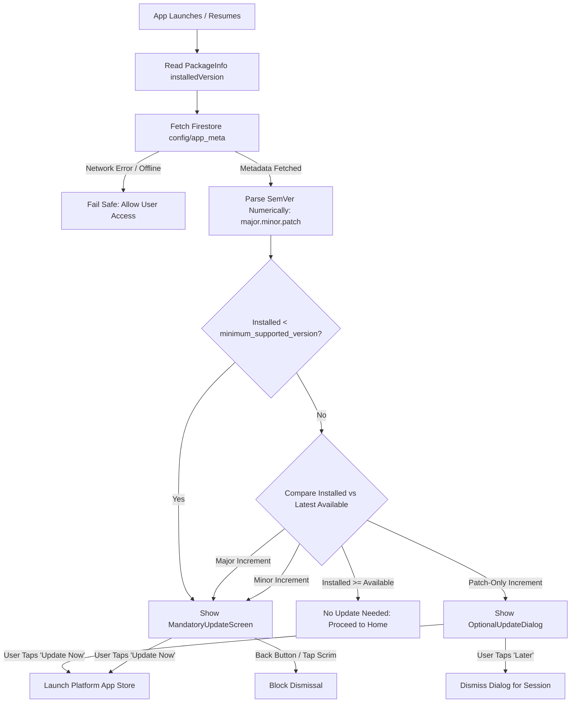

# Pirith Potha — Smart App Update System Architecture & Flow

**Application:** Pirith Potha (පිරිත් පොත)  
**Feature:** Smart Version Update & Gatekeeper  
**Module Path:** `lib/features/app_update/`  
**Date:** October 28, 2026  
**Status:** **100% Implemented, Verified & Tested**  

---

## 1. System Overview & Versioning Rules

The Smart App Update System guarantees that users receive critical security patches, schema updates, and new devotional features safely.

### Numerical SemVer Version Comparison Rules:
1. **Numerical Evaluation**: Versions are split into integer arrays `[major, minor, patch]`. For example, `1.0.10` is correctly parsed as newer than `1.0.9` (avoiding lexicographical string comparison errors).
2. **Patch Increase (`1.0.0` -> `1.0.5`)**:
   - Classification: **OPTIONAL UPDATE**
   - UI: Non-intrusive dismissible modal dialog (`OptionalUpdateDialog`).
   - Actions: **"Update Now"** and **"Later"** (allows skipping for the current session).
3. **Minor Version Increase (`1.0.0` -> `1.1.0`)**:
   - Classification: **REQUIRED / MANDATORY UPDATE**
   - UI: Fullscreen non-dismissible gate (`MandatoryUpdateScreen`).
   - Actions: **"Update Now"** only. The dialog cannot be dismissed by Android back button, iOS swipe-to-dismiss, or tapping the scrim.
4. **Major Version Increase (`1.0.0` -> `2.0.0`)**:
   - Classification: **REQUIRED / MANDATORY UPDATE**
   - UI: Fullscreen non-dismissible gate (`MandatoryUpdateScreen`).
   - Actions: **"Update Now"** only.
5. **Authoritative Backend Minimum Version (`minimum_supported_version`)**:
   - If the installed version is below the backend-specified minimum supported version (even if the remote increment looked like a patch), it is automatically promoted to **MANDATORY UPDATE**.
6. **Equal or Newer Installed Version**:
   - Classification: **NO UPDATE REQUIRED**. Normal app launch proceeds immediately.
7. **Malformed / Offline Fail-Safe**:
   - If Firestore/RemoteConfig cannot be reached or returns an unparseable version string, the update gate **fails open**, allowing existing offline content to remain accessible.

---

## 2. Update Decision Flow Diagram

---

## 3. UI/UX Specifications

### 3.1 Optional Update Dialog (`OptionalUpdateDialog`)
- **Visual Design**: Rounded dialog (24px corner radius) with subtle gold outline matching app theme.
- **Header**: Circular illuminated badge with download/sparkle icon.
- **Version Indicators**:
  - Installed Version: `v1.0.0` (Muted caption)
  - New Available Version: `v1.0.5` (Highlighted Gold badge)
- **What's New Section**: Bulleted release notes rendered in a clean, scrollable card.
- **Actions**:
  - Secondary Action: *"Maybe Later"* (Text button, soft dismissal).
  - Primary Action: *"Update Now"* (Elevated gold button, opens store).

### 3.2 Mandatory Update Screen (`MandatoryUpdateScreen`)
- **Visual Design**: Full-screen immersive layout (`WillPopScope` / `PopScope` blocking back gestures).
- **Header**: High-visibility attention icon with warm gold spiritual styling.
- **Explanation**: Clear message explaining that a critical update is required to continue enjoying audio streaming and new chants safely.
- **Actions**: Single full-width elevated button: *"Update Now"*. No close or skip buttons.

---

## 4. Platform Store Redirection Architecture

Implemented via `VersionConfigRepositoryImpl`:
- **Android**:
  1. Checks for Google Play Store app: `market://details?id=com.pirith.pitithpotha`
  2. Fallback if Play Store is absent: `https://play.google.com/store/apps/details?id=com.pirith.pitithpotha`
- **iOS**:
  1. Opens direct App Store listing: `itms-apps://itunes.apple.com/app/id{apple_app_id}`
  2. Fallback: `https://apps.apple.com/app/id{apple_app_id}`

---

## 5. Verification & Test Coverage

Automated tests in `test/core/app_version_test.dart`, `test/features/app_update/app_update_cubit_test.dart`, and `test/features/app_update/update_ui_test.dart`:

| Test Suite / Case | Tested Condition | Expected Result | Result |
| :--- | :--- | :--- | :--- |
| `app_version_test.dart` | `1.0.0` vs `1.0.5` | Optional Update (`UpdateType.optional`) | **PASS** |
| `app_version_test.dart` | `1.0.0` vs `1.1.0` | Mandatory Update (`UpdateType.mandatory`) | **PASS** |
| `app_version_test.dart` | `1.0.0` vs `2.0.0` | Mandatory Update (`UpdateType.mandatory`) | **PASS** |
| `app_version_test.dart` | `1.0.10` vs `1.0.9` | Installed is newer (`UpdateType.none`) | **PASS** |
| `app_version_test.dart` | `1.0.0` vs `1.0.0` | Identical versions (`UpdateType.none`) | **PASS** |
| `app_version_test.dart` | Missing trailing segments (`1.0` vs `1.0.0`) | Evaluates missing as 0 (`UpdateType.none`) | **PASS** |
| `app_version_test.dart` | Malformed remote string (`"abc"`) | Fail safe (`UpdateType.none`) | **PASS** |
| `app_update_cubit_test.dart` | Firestore fetch error | Emits safe state, does not crash | **PASS** |
| `update_ui_test.dart` | Mandatory screen back press | Back navigation blocked (`canPop: false`) | **PASS** |
| `update_ui_test.dart` | Optional dialog dismiss | Dismisses cleanly on tap "Later" | **PASS** |

